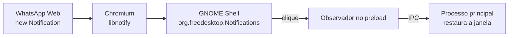

<div align="center">


# wa-gnome

**WhatsApp Web no Ubuntu/GNOME como um app de verdade.**
Bandeja, notificações com a janela fechada e início com o sistema, sem depender do Google Chrome.

[](https://www.electronjs.org/)
[](https://www.typescriptlang.org/)
[](https://vitest.dev/)
[](https://www.gnome.org/)
[](https://ubuntu.com/)
[](#licença)

[Instalação](#-instalação) ·
[Recursos](#-recursos) ·
[Como funciona](#-como-funciona) ·
[Desenvolvimento](#-desenvolvimento) ·
[Perguntas frequentes](#-limitações-e-perguntas-frequentes)

</div>

---

## ✨ Recursos

| | |
|---|---|
| 🔔 **Notificações em segundo plano** | Feche a janela e continue recebendo mensagens. Clicar na notificação abre a conversa. |
| 🗂️ **Ícone na bandeja** | Ponto vermelho e contador de conversas não lidas, menu com Abrir / Ocultar / Sair. |
| 🚀 **Iniciar com o sistema** | Abre minimizado na bandeja ao fazer login, integrado ao autostart do GNOME. |
| 🔒 **Seguro por padrão** | Sandbox do Chromium ativo, só `web.whatsapp.com` carrega na janela, permissões negadas por padrão. |
| 💾 **Sessão persistente** | Escaneie o QR Code uma vez; a sessão sobrevive a reinícios. |
| 🐧 **Integração nativa** | Wayland nativo, lançador no menu de aplicativos, agrupamento correto no dock. |
| 📦 **AppImage e .deb** | Pacote `.deb` com perfil AppArmor para o Ubuntu 24.04+ e AppImage com runtime estático (sem `libfuse2`). |
| 🕵️ **Sem conteúdo nos logs** | O texto das mensagens nunca passa pelo processo principal nem é registrado em disco. |

> [!NOTE]
> O wa-gnome é um projeto independente e **não é afiliado ao WhatsApp nem à Meta**.
> Ele apenas carrega o WhatsApp Web oficial numa janela própria. Os ícones são arte original.

## 📥 Instalação

Baixe o pacote na página de [Releases](https://github.com/gabrielf-agostinho/wa-gnome/releases)
ou [gere a partir do código](#-gerando-os-pacotes).

### .deb (Ubuntu / Debian)

```bash
sudo apt install ./wa-gnome_0.1.0_amd64.deb
```

Instala em `/opt/wa-gnome`, cria o comando `wa-gnome`, a entrada no menu de aplicativos
e o perfil AppArmor necessário para o sandbox do Chromium no Ubuntu 24.04+.
Para remover: `sudo apt remove wa-gnome`.

### AppImage

```bash
chmod +x wa-gnome-0.1.0-x86_64.AppImage
./wa-gnome-0.1.0-x86_64.AppImage --install-desktop-entry   # opcional: adiciona ao menu
./wa-gnome-0.1.0-x86_64.AppImage
```

> [!TIP]
> **Não vê o ícone na bandeja?** O GNOME puro não mostra ícones de bandeja. No Ubuntu a
> extensão *Ubuntu AppIndicators* já vem ativa; em outras distribuições instale
> *AppIndicator and KStatusNotifierItem Support*. Sem bandeja, o app avisa por notificação
> que continua rodando e como reabri-lo.

## 🖱️ Uso

| Ação | Resultado |
|------|-----------|
| Fechar a janela (**X**) | Oculta a janela; conexão e notificações continuam |
| Clique no ícone da bandeja | Abre e foca a janela |
| Abrir o app de novo pelo menu | Restaura a janela existente (instância única) |
| Bandeja → **Sair** ou **Ctrl+Q** | Encerra de verdade, gravando a sessão em disco |
| Bandeja → **Iniciar com o sistema** | Liga/desliga o autostart |

**Linha de comando**

| Flag | Efeito |
|------|--------|
| `--hidden` | Inicia só na bandeja (usado pelo autostart) |
| `--install-desktop-entry` | Instala lançador e ícones em `~/.local/share` |
| `--uninstall-desktop-entry` | Remove o lançador e os ícones |

**Arquivos**

| O quê | Onde |
|-------|------|
| Configurações | `~/.config/wa-gnome/settings.json` |
| Sessão do WhatsApp | `~/.config/wa-gnome/Partitions/whatsapp` |
| Autostart | `~/.config/autostart/io.github.wagnome.WaGnome.desktop` |
| Logs | `~/.local/state/wa-gnome/wa-gnome.log` |

## ⚙️ Como funciona



1. O WhatsApp Web chama `new Notification()` na própria página.
2. O Chromium entrega a notificação ao GNOME Shell via D-Bus, com o `desktop-entry` do app
   (nome e ícone corretos).
3. Fechar a janela só a **oculta**: a página continua viva e, graças às flags em
   [`background.ts`](src/main/background.ts), com timers em velocidade normal, mas sem
   ficar "visível" (o que poderia marcar conversas como lidas).
4. Ao clicar na notificação, um observador instalado pelo preload avisa o processo principal,
   que restaura a janela; o handler do próprio WhatsApp abre a conversa.

<details>
<summary><b>🔬 O que foi verificado (Electron 45.3.3, GNOME 50, Wayland)</b></summary>

| Item | Resultado |
|------|-----------|
| Push API (`pushManager.subscribe`) | ❌ `AbortError: push service not available`: o Electron não traz o FCM do Chrome |
| `ServiceWorkerRegistration.showNotification` | ❌ nenhuma chamada `Notify` no D-Bus: o Electron não implementa notificações persistentes |
| `new Notification()` com a janela oculta | ✅ chega no D-Bus (`Notify`) e o evento `show` dispara |
| Mesma `tag` | ✅ substitui a anterior (mesmo `replaces_id`), sem duplicata |
| Página oculta por 6,5 min | ✅ `visibilityState: hidden`, timers de 1 s com intervalo máximo de 1005 ms |
| Clique → janela | ✅ restaura a janela e o `onclick` da página continua rodando |
| `window.focus()` da página | ❌ não mostra a janela oculta, por isso existe o observador |

**Escolha do modo de segundo plano** (janela oculta por 6,5 min):

| Configuração | Visibilidade | Intervalo máx. entre timers de 1 s |
|---|---|---|
| `backgroundThrottling: false` | `visible` | 1004 ms |
| `backgroundThrottling: true` | `hidden` | **59 s** (*intensive wake-up throttling*) |
| `true` + `--disable-background-timer-throttling` + `--disable-features=IntensiveWakeUpThrottling` | `hidden` | 1005 ms |

`visible` com a janela oculta é ruim: o WhatsApp pode tratar a conversa aberta como lida e
enviar confirmação de leitura indevida. A terceira linha reproduz uma aba do Chrome em segundo
plano, mas sem limitar os timers.

</details>

<details>
<summary><b>🛡️ Segurança</b></summary>

- `contextIsolation: true`, `sandbox: true`, `nodeIntegration: false`, `webSecurity: true`.
- Só a origem `https://web.whatsapp.com` é carregada na janela. Links e `window.open` vão para
  o navegador padrão (apenas `http(s)`, `mailto`, `tel`). Redirecionamentos para fora e
  `<webview>` são bloqueados.
- Permissões são negadas por padrão. A origem do WhatsApp recebe só `notifications`,
  `media` (microfone/câmera), `clipboard-sanitized-write` e `fullscreen`.
- **User-Agent:** o do próprio Electron, sem fingir ser o Chrome. A única alteração é remover
  o token `wa-gnome/<versão>` que o Electron insere; com ele, o WhatsApp exibe "funciona no
  Google Chrome 100 ou posterior" em vez do QR Code. Veja [`user-agent.ts`](src/main/user-agent.ts).
- **Sessão:** partição `persist:whatsapp`, gravada com `flushStorageData()` antes de sair.
  Só uma instância é permitida, pois dois processos no mesmo perfil podem corromper o LevelDB.

</details>

<details>
<summary><b>🚀 Inicialização automática e configurações</b></summary>

- **Iniciar com o sistema** cria ou remove o `.desktop` em `~/.config/autostart`, seguindo a
  spec XDG Autostart que o GNOME implementa.
- **O estado vem do próprio arquivo:** se você desativar pelo GNOME Tweaks
  (`X-GNOME-Autostart-enabled=false` / `Hidden=true`) ou apagar o arquivo, o menu se atualiza
  na hora (inotify).
- **No login o app abre com `--hidden`:** a página carrega como `hidden`
  (`paintWhenInitiallyHidden: false`), com notificações funcionando e sem marcar como lida a
  conversa aberta.
- **`X-GNOME-Autostart-Delay=3`** dá tempo para a extensão AppIndicator registrar a bandeja.
- **Correção automática:** se o caminho de execução mudar (AppImage movido, outro checkout),
  o `Exec` é reescrito na próxima inicialização.

`settings.json` tem chaves validadas, escrita atômica, e um arquivo corrompido é movido para
`.corrupt`:

| Chave | Padrão | Efeito |
|-------|--------|--------|
| `startHiddenOnLogin` | `true` | autostart inicia com `--hidden` |

</details>

<details>
<summary><b>📝 Logs e erros</b></summary>

- **Arquivo:** `~/.local/state/wa-gnome/wa-gnome.log` (`$XDG_STATE_HOME`), pasta `0700` e
  arquivo `0600`. Gira em 1 MiB e mantém 3 arquivos antigos (`.1`–`.3`).
- **O que entra:** início (versões, Wayland/X11), janela mostrada/oculta, bandeja, autostart,
  falhas de carregamento com nova tentativa, renderer travado, processos filhos que caem,
  exceções não tratadas. **Nunca** o conteúdo das mensagens.
- **Erro fatal na inicialização:** uma caixa de diálogo mostra o erro e o caminho do log; o
  app sai com código 1.
- **Encerramento:** "Sair", Ctrl+Q e SIGTERM (logout, `kill`) passam pelo `before-quit`, que
  grava a sessão em disco.
- `WA_GNOME_DEBUG=1` ativa logs de debug e o menu padrão do Electron (Ctrl+Shift+I abre o DevTools).

</details>

## 🛠️ Desenvolvimento

**Stack:** Electron 45 (Chromium 156, Node 24) · TypeScript 7 (strict) · electron-vite 6 / Vite 8 · Vitest

```bash
git clone https://github.com/gabrielf-agostinho/wa-gnome.git
cd wa-gnome
npm install
npm run dev
```

| Script | Descrição |
|--------|-----------|
| `npm run dev` | electron-vite com hot reload do main/preload |
| `npm run build` | gera `out/` |
| `npm start` | roda o build atual |
| `npm run typecheck` | `tsc -b` (strict) |
| `npm test` | Vitest |
| `npm run check` | typecheck + testes + build |
| `npm run desktop:install` | instala lançador e ícones em `~/.local/` |
| `npm run desktop:uninstall` | remove o lançador |
| `npm run dist` | check + AppImage e `.deb` em `dist/` |
| `npm run dist:appimage` · `dist:deb` · `dist:dir` | gera só um formato |

> [!WARNING]
> **VS Code:** o terminal integrado exporta `ELECTRON_RUN_AS_NODE=1`, o que faz o Electron
> rodar como Node puro (`Cannot find module 'electron'`). Os scripts `dev`/`start` removem
> essa variável com `env -u`; faça o mesmo se chamar `npx electron` diretamente.

### 📦 Gerando os pacotes

```bash
npm run dist
ls dist/   # wa-gnome-0.1.0-x86_64.AppImage  wa-gnome_0.1.0_amd64.deb
```

- **.deb:** o `postinst` instala o perfil AppArmor `/etc/apparmor.d/wa-gnome` (só `userns`,
  sem confinamento), exigido pelo Ubuntu 24.04+ para o sandbox do Chromium
  (`kernel.apparmor_restrict_unprivileged_userns=1`). Dependências conferidas no Ubuntu 26.04.
- **AppImage:** usa o runtime estático (`toolsets.appimage: 1.0.3`), já que o Ubuntu 24.04+
  não instala mais a `libfuse2`. O sandbox continua ativo (user/PID namespaces + seccomp).

Configuração em [`electron-builder.yml`](electron-builder.yml) e
[`scripts/after-pack.cjs`](scripts/after-pack.cjs). Os ícones são gerados por
`python3 scripts/generate-icons.py` (requer Pillow).

### 🗺️ Arquitetura

Não há `src/renderer/`: a interface é o próprio `https://web.whatsapp.com/`.

<details>
<summary>Estrutura de <code>src/</code></summary>

```text
src/
├── shared/
│   ├── constants.ts            URL, origem, partição de sessão, desktop ID
│   └── ipc.ts                  canais IPC preload → main
├── main/
│   ├── index.ts                bootstrap: instância única, sessão, janela, bandeja
│   ├── background.ts           switches do Chromium p/ execução em 2º plano
│   ├── notifications.ts        clique → restaurar janela, contagem
│   ├── autostart.ts            ~/.config/autostart/<id>.desktop (+ inotify)
│   ├── settings.ts             settings.json tipado, escrita atômica
│   ├── desktop-integration.ts  lançador + ícones hicolor em ~/.local/share
│   ├── desktop-entry.ts        gerar/ler .desktop (quoting do Exec conforme a spec)
│   ├── launch.ts               comando que inicia esta instalação (dev, AppImage, .deb)
│   ├── cli.ts / xdg.ts         flags de linha de comando, diretórios XDG
│   ├── lifecycle.ts            instância única, flush da sessão, log de crashes
│   ├── session.ts              partição persist:whatsapp + permissões
│   ├── window.ts               criar/mostrar/ocultar, X → ocultar, navegação
│   ├── tray.ts                 ícone, menu, contador de não lidas
│   ├── tray-support.ts         detecta host StatusNotifierItem no D-Bus
│   ├── unread.ts               não lidas a partir do título "(N) WhatsApp"
│   ├── user-agent.ts           remove o token "wa-gnome/x.y.z" do UA
│   ├── context-menu.ts         menu de edição + corretor ortográfico
│   ├── policy.ts               regras puras (URLs, permissões)
│   └── logger.ts               console + arquivo com rotação
└── preload/
    ├── index.ts                    sandbox + contextIsolation; instala o observador
    └── notification-observer.ts    observa show/click da Notification padrão
```

</details>

## ❓ Limitações e perguntas frequentes

<details>
<summary><b>Recebo notificações com o app fechado?</b></summary>

Só se o processo estiver rodando. O Electron não tem Web Push, então não há notificação
depois de *Sair* ou durante a suspensão. Com *Iniciar com o sistema* ativo, o app já está
rodando após o login; ao acordar da suspensão, o WhatsApp reconecta e entrega as pendentes.
Não existe API pública do WhatsApp que permita outra abordagem.

</details>

<details>
<summary><b>Cliquei na notificação e apareceu "WhatsApp está pronto" em vez da janela</b></summary>

É a prevenção de roubo de foco do GNOME no Wayland: o compositor pode recusar dar foco a uma
janela restaurada. Clique no aviso para trazê-la para frente.

</details>

<details>
<summary><b>Vejo avisos de <code>vaInitialize</code>/Vulkan no terminal</b></summary>

Ruído do Chromium; não afeta o app. Se notar algum problema gráfico, compare com X11:
`env -u ELECTRON_RUN_AS_NODE npx electron . --ozone-platform=x11` (após `npm run build`).

</details>

<details>
<summary><b>"GPU process isn't usable. Goodbye." no log ao fazer logout</b></summary>

No logout o systemd envia SIGTERM ao escopo inteiro e os processos filhos morrem junto com o
principal. Isso acontece depois do `before-quit`, ou seja, depois de a sessão já ter sido
gravada em disco.

</details>

## Licença

Distribuído sob a [licença MIT](LICENSE). WhatsApp é marca registrada da Meta Platforms, Inc.;
este projeto não tem relação com a empresa.
